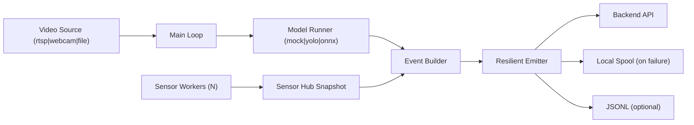

# be-ai-endpoint

Single-camera runtime for capstone delivery.

Python baseline: **3.11**

## Scope

- One process handles exactly one camera input.
- One process can ingest multiple sensors concurrently.
- Video source options: `rtsp`, `webcam`, `file`.
- Model options (internal switch, no plugin loading): `mock`, `yolo`, `onnx`.
- Output: backend API with resilient local spool queue.

## Runtime Topology



## Quick Start

### 1) Install

```bash
pip install -r requirements.txt -r requirements-dev.txt
```

### 2) Dry-run with file source

```bash
PYTHONPATH=src python -m capruntime --config configs/runtime.yaml --dry-run --max-events 10
```

### 3) RTSP to backend

```bash
PYTHONPATH=src python -m capruntime \
  --config configs/runtime.yaml \
  --source-type rtsp \
  --rtsp-url rtsp://127.0.0.1:8554/stream1 \
  --max-events 50
```

### 4) Webcam

```bash
PYTHONPATH=src python -m capruntime --source-type webcam --camera-index 0 --dry-run
```

## Environment Variables

Use `.env.example` as the baseline.

Prefix: `CR_`

- `CR_SOURCE_TYPE`
- `CR_MODEL_TYPE`
- `CR_BACKEND_URL`
- `CR_SPOOL_FILE_PATH`

## Legacy Status

Previous implementation was removed from the active repository snapshot.
Current repository content is runtime v2 only.

## Test

```bash
PYTEST_DISABLE_PLUGIN_AUTOLOAD=1 pytest -q
python scripts/test_hygiene.py --strict --max-duplicate-groups 0 --max-no-assert 0 --max-trivial-assert-true 0
```
