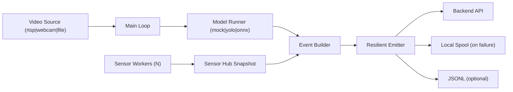

# be-ai-endpoint

Single-camera runtime for capstone delivery.

Python baseline: **3.11**

## Team Sharing Entry

For cross-team coordination, start here first:

- shared docs entry: `docs/shared/README.md`
- official team contract: `docs/shared/team_contract.md`
- shared examples: `docs/shared/schema_examples.md`
- shared glossary: `docs/shared/glossary.md`

## Scope

- One process handles exactly one camera input.
- One process can ingest multiple sensors concurrently.
- Video source options: `rtsp`, `webcam`, `file`.
- Model options (internal switch, no plugin loading): `mock`, `yolo`, `onnx`.
- Output: backend API with resilient local spool queue.

## Runtime Topology



## Quick Start

### 1) Install

```bash
pip install -r requirements.txt -r requirements-dev.txt
```

### 2) File dry-run

```bash
PYTHONPATH=src python -m capruntime --config configs/runtime.yaml --dry-run --max-events 10
```

### 3) RTSP input

```bash
PYTHONPATH=src python -m capruntime \
  --config configs/runtime.yaml \
  --source-type rtsp \
  --rtsp-url rtsp://127.0.0.1:8554/stream1 \
  --max-events 50
```

### 4) Webcam input

```bash
PYTHONPATH=src python -m capruntime --source-type webcam --camera-index 0 --dry-run
```

### 5) Dual camera (two processes)

```bash
PYTHONPATH=src CR_SPOOL_FILE_PATH=outputs/spool/cam1_pending.jsonl python -m capruntime --source-type rtsp --rtsp-url rtsp://127.0.0.1:8554/cam1 --camera-id cam01 --model-type mock --dry-run --output-jsonl outputs/cam1_events.jsonl --fps-limit 10
```

```bash
PYTHONPATH=src CR_SPOOL_FILE_PATH=outputs/spool/cam2_pending.jsonl python -m capruntime --source-type rtsp --rtsp-url rtsp://127.0.0.1:8554/cam2 --camera-id cam02 --model-type mock --dry-run --output-jsonl outputs/cam2_events.jsonl --fps-limit 10
```

## Operations And Demo

- shared team docs: `docs/shared/README.md`
- service deployment: `docs/operations.md`
- demo scenarios: `docs/demo_scenarios.md`
- performance/resilience report: `docs/performance_report.md`
- legacy team alignment pointer: `docs/team_alignment.md`
- runbook: `docs/runbook.md`

## Environment Variables

Use `.env.example` as the baseline (`CR_` prefix).

## Capstone Delivery Checklist

- one process per camera verified
- multi-sensor per process verified
- backend outage to spool fallback verified
- RTSP reconnect behavior documented
- systemd operation template provided

## Test

```bash
PYTEST_DISABLE_PLUGIN_AUTOLOAD=1 pytest -q
python scripts/test_hygiene.py --strict --max-duplicate-groups 0 --max-no-assert 0 --max-trivial-assert-true 0
```

## Legacy Status

Previous implementation was removed from the active repository snapshot.
Current repository content is runtime v2 only.
