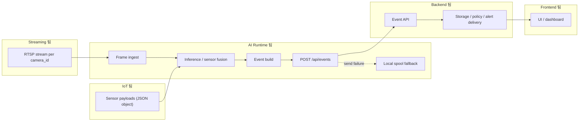

# AI Runtime 팀 경계도

이 문서는 팀 간 경계와 데이터 흐름을 설명하는 대표 문서다.

## 핵심 문장

- AI Runtime은 이벤트 생성까지 책임진다.
- 최종 알림 정책과 최종 사용자 알림 전파는 백엔드 책임이다.
- 프론트엔드는 AI Runtime에 직접 연결되는 것이 아니라, 백엔드가 제공하는 데이터와 상태를 기준으로 동작한다.

## 경계 요약

- Streaming 팀 경계: 카메라별로 안정적인 RTSP 스트림을 제공하고 운영한다.
- IoT 팀 경계: 센서 이름, 주기, stale 기준이 있는 JSON 객체 payload를 제공한다.
- AI Runtime 팀 경계: 영상과 센서를 소비하고 추론/융합 후 이벤트를 생성해 백엔드에 전달한다.
- Backend 팀 경계: 이벤트를 저장하고 정책을 적용하며 최종 알림을 전파한다.
- Frontend 팀 경계: 상태와 이벤트를 시각화하고 운영 UI를 제공한다.

## 문서 연결

- 상세 계약: [team_contract.md](team_contract.md)
- 예시 JSON과 표: [schema_examples.md](schema_examples.md)
- 용어 설명: [glossary.md](glossary.md)
