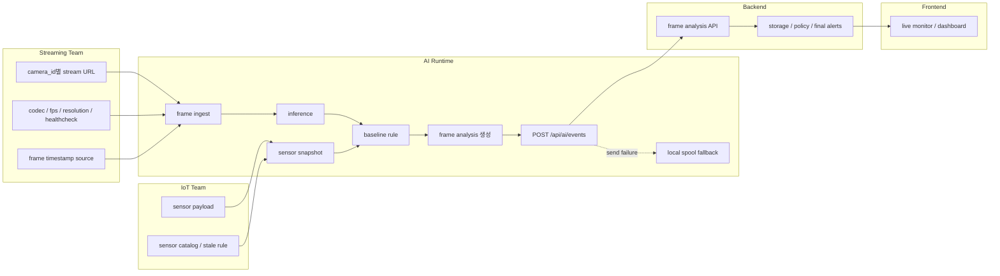

# AI Runtime 시스템 경계

이 문서는 AI Runtime이 어디까지 책임지고, 다른 팀과 어떤 데이터를 주고받는지 설명한다. 목적은 팀별 구현이 같은 frame analysis 계약을 기준으로 맞물리게 하는 것이다.



## 핵심 기준

- AI Runtime은 영상 프레임을 읽고, 모델 추론과 baseline rule을 적용한 뒤 frame analysis payload를 만든다.
- Backend는 payload 저장, 중복 처리, 최종 알림 정책을 책임진다.
- Frontend는 backend 또는 event bridge가 제공하는 frame analysis 데이터를 시각화한다.
- Streaming은 안정적인 영상 입력, camera metadata, frame timestamp 기준을 제공한다.
- IoT는 sensor payload와 센서의 의미, 위치, stale/offline 기준을 제공한다.

## 출력 계약

AI Runtime의 공식 출력은 `POST /api/ai/events`로 보내는 frame analysis JSON이다.

```text
analysis_id
camera_id
frame_id / frame_ts
zones[]
detections[]
sensors
alerts[]
```

객체 1개당 JSON 1개를 보내던 old event 방식은 legacy 호환용이다. 새 연동에서는 같은 프레임의 여러 detection을 한 payload에 담는다.

## 안정성 기준

- Backend 장애가 발생해도 runtime loop는 중단하지 않는다.
- 전송에 실패한 payload는 local spool에 저장한다.
- 센서 입력이 실패해도 camera loop는 중단하지 않는다.
- RTSP stream이 일시적으로 끊기면 같은 URL로 재연결을 시도해야 한다.

## 관련 문서

- 상세 계약: [team_contract.md](team_contract.md)
- JSON 예시: [schema_examples.md](schema_examples.md)
- 용어 정리: [glossary.md](glossary.md)
