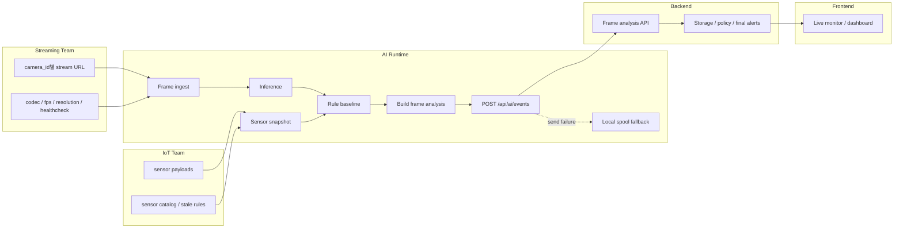

# AI Runtime Boundary

이 문서는 팀 사이의 책임 경계와 데이터 흐름을 설명한다.



## 핵심 문장

- AI Runtime은 프레임 분석 payload 생성까지 책임진다.
- Backend는 payload 저장, 중복 처리, 최종 알림 정책을 책임진다.
- Frontend는 backend 또는 event bridge가 제공하는 frame analysis 데이터를 시각화한다.
- Streaming은 안정적인 영상 입력과 camera metadata를 제공한다.
- IoT는 센서 payload와 센서 의미를 제공한다.

## Output Contract

AI Runtime의 현재 공식 출력은 `POST /api/ai/events`로 보내는 frame analysis JSON이다.

```text
analysis_id
camera_id
frame_id / frame_ts
zones[]
detections[]
zone_matches[]
sensors
alerts[]
```

객체 1개당 JSON 1개를 보내던 old event 방식은 legacy 호환용이다.

## Runtime Reliability

- Backend outage must not stop runtime.
- Failed sends are stored in local spool.
- Sensor failure must not stop camera loop.
- RTSP reconnect should recover transient stream failure.

## Linked Docs

- Detailed contract: [team_contract.md](team_contract.md)
- JSON examples: [schema_examples.md](schema_examples.md)
- Glossary: [glossary.md](glossary.md)
